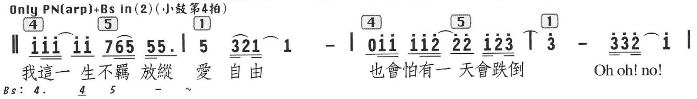

# 项目远景与原型



### 一、整体结构

- **记谱法**：简谱，用数字 1–7 表示音高。
- **拍号**：4/4，每小节 4 拍。
- **范围**：共 4 个小节，分成两个乐句，每句 2 小节。
- **开头**：有反复起始记号 `‖`（粗细双线）。
- **小节线**：第 3、4 小节之间的小节线上有跨小节的连音线，形状像 `⊤`。

### 二、骨架：从上到下的层次

#### 1. 和弦层（顶部方框数字）

和弦用级数（1、4、5，即 I、IV、V）写在方框里，对齐到它开始的那一拍：

| 小节 | 第1拍 | 第2拍 | 第3拍 | 第4拍 |
| ---- | ----- | ----- | ----- | ----- |
| 1    | [4]   |       | [5]   |       |
| 2    | [1]   |       |       |       |
| 3    | [4]   |       | [5]   |       |
| 4    | [1]   |       |       |       |

和弦一直持续，直到下一个和弦出现为止。所以和弦需要能对齐到"拍"这一级，不能只对齐到小节。

#### 2. 旋律音高层（数字）

- **数字 1–7**：音高。**0** 表示休止符。
- **数字上方的点**：高八度，例如 i̇、2̇、3̇。本段大部分是高音区。数字下方如果有点则表示低八度，本段没有出现。
- **`-`**：延长一拍。
- **数字后的 `.`**：附点，例如第 1 小节的 `5.`。
- **弧线**：连音线或圆滑线，有时跨音组，有时跨小节。例如 `321⌒1`、`3̇ ⌒ |`、`3̇3̇2̇⌒i̇`。

各小节按拍分组如下：

| 小节 | 第1拍 | 第2拍 | 第3拍 | 第4拍 |
| ---- | ----- | ----- | ----- | ----- |
| 1    | i̇i̇i̇   | ⌒i̇i̇   | 765   | 55.   |
| 2    | 5     | 321   | ⌒1    | -     |
| 3    | 0i̇i̇   | i̇i̇2̇   | ⌒2̇2̇   | i̇2̇3̇ ⌒ |
| 4    | 3̇     | -     | 3̇3̇2̇   | ⌒i̇    |

#### 3. 时值层（数字下方的横线）

- **没有横线**：四分音符，1 拍。
- **一条横线**：八分音符，半拍。
- **两条横线**：十六分音符，1/4 拍。
- **横线的分组**：横线把同一拍内的音连在一起，因此视觉上就是"拍"的分组边界。例如 `765` 下面是一条长横线，后两个音再多一条，即八分加两个十六分。

#### 4. 歌词层（最下方）

歌词逐字对齐到音符：

- 第一句：我這一 生不羈 放縱 愛 自 由
- 第二句：也會怕有一 天會跌倒
- 结尾：Oh oh! no!

一个字可以对应多个音（拖腔），休止符和延长线下面没有字。

**对开发的含义**：每个小节按拍号切成 N 个拍格（4/4 是 4 格，3/4 是 3 格）。和弦、音符组、歌词都要对齐到拍格。拍格内部再按时值（横线数）细分。

### 三、补充信息（可选显示层）

#### 黄色框：演奏/编配提示（左上角文字）

```
Only PN(arp)+Bs in(2)(小鼓第4拍)
```

意思是：在第 2 遍（反复时）只有钢琴（PN）弹分解和弦（arp）加贝斯（Bs）进入，小鼓在第 4 拍击打。

这是一条**乐段级的文字注释**，挂在段落开头。它的生效条件是"第几遍"，不对应具体音符。

#### 绿色框：贝斯声部（歌词下方）

```
Bs: 4.   4̲   5   -   ~
```

这是写给贝斯手的简化低音线，与第 1 小节对齐：

- `4.`：附点四分音符，1.5 拍。
- `4̲`：八分音符，0.5 拍。
- `5`：1 拍。
- `-`：再延长 1 拍。
- `~`：表示后面按同样的模式继续，不再逐小节写出。

它的音高正好跟着上方和弦根音走（4 → 5）。所以它是一条**独立的声部行**，只写出前面一小段，后面用 `~` 省略。